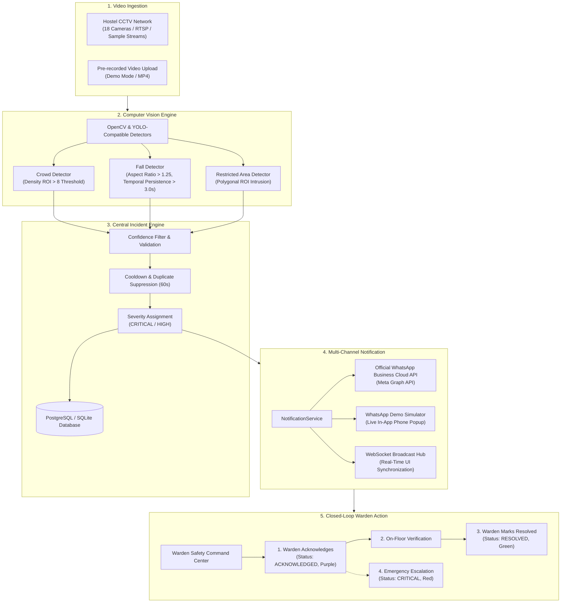

# HOSTELGUARD AI
> **"See the Risk. Prevent the Incident."**  
> *AI-Powered Hostel Safety & Autonomous Incident Response Command Center*

---

## 📌 Executive Summary

**HostelGuard AI** transforms conventional, passive hostel CCTV cameras into an intelligent, proactive safety monitoring system. Instead of burdening a single warden with continuously watching dozens of video feeds on a security wall, HostelGuard AI automatically analyzes CCTV video streams in real-time to identify dangerous situations—such as overcrowding, human falls, and unauthorized restricted area intrusions—and immediately dispatches structured alerts directly to the warden's WhatsApp with a closed-loop resolution workflow.

> **"HostelGuard AI does not replace CCTV. It makes CCTV intelligent."**  
> *From passive surveillance to proactive safety.*

---

## 🏗️ System Architecture & Closed-Loop Workflow



---

## ✨ Key Features

1. **Autonomous Computer Vision Detection**:
   - **Crowd Gathering**: Monitors corridor density, flags gatherings exceeding thresholds (e.g. 12 people > limit 8).
   - **Possible Fall**: Detects horizontal body posture on the corridor floor with temporal persistence (> 3.0 seconds continuous) to prevent false alerts from sitting or tying shoes.
   - **Restricted Area Entry**: Polygonal Region of Interest (ROI) boundary monitoring for maintenance zones and nighttime curfew compliance.
   - **Architectural Extensibility**: Modular stubs ready for liquid/spill detection, fire flicker, and volumetric smoke diffusion.

2. **Official WhatsApp Business Cloud API & Demo Fallback**:
   - Dispatches concise, professional incident alerts directly to the warden's mobile phone via Meta's Graph API.
   - **Demo Notification Mode**: If Meta API credentials are not set during a presentation, the system gracefully operates in simulation mode—generating real-time delivery timelines and displaying a high-fidelity interactive **WhatsApp Phone Simulator popup** right on the dashboard.

3. **Closed-Loop Incident Management**:
   - **3-Step Status Pipeline**: `DETECTED` (Tangerine) ➔ `ACKNOWLEDGED` (Purple) ➔ `RESOLVED` (Green).
   - Real-time response time and resolution time tracking for audit compliance.

4. **Interactive 2D Hostel Architectural Map**:
   - Spatial layout of Block A (Floor 1 & 2), Block B (Ground Floor & Floor 3), Dining Hall, and Security Gates.
   - Real-time pulsating status pins with click-to-view camera feeds.

5. **Hackathon AI Demo Center & Full-Screen Presentation Mode**:
   - 3 one-click scenarios (`Demo 1: Crowd`, `Demo 2: Possible Fall`, `Demo 3: Restricted Area`).
   - Live AI HUD with frame scanlines, bounding boxes, person counters, and real-time event timelines.
   - 7-step guided presentation mode designed for projector demonstrations.

6. **Safety Operations Design Palette**:
   - **Oat (`#F3EBDD` / `#FAF7F0`)**: Main application background and content surfaces.
   - **Purple (`#6C4AB6` / `#4B347F`)**: Primary brand identity, AI badges, and active states.
   - **Tangerine (`#F28C28` / `#FFF0DD`)**: Warnings, crowd alerts, attention states, and pending actions.
   - **Red (`#DC2626`)**: Strictly reserved for CRITICAL emergencies (falls, fire).
   - **Green (`#16A34A`)**: Strictly reserved for Normal, Online, and Resolved states.

---

## 🛠️ Technology Stack

| Layer | Technology | Description |
|---|---|---|
| **Frontend** | React 18 / Vite / TypeScript | Ultra-responsive SPA with sub-second hot reloading |
| **Styling** | Tailwind CSS v4 | Curated Oat/Purple/Tangerine color tokens & modern typography |
| **Icons & Audio** | Lucide React + Web Audio API | Custom synthesized dual-tone safety chimes & emergency alarms |
| **Backend** | Python 3.11+ / FastAPI | High-concurrency async REST API & WebSocket server |
| **Computer Vision** | OpenCV / NumPy / YOLO Compatible | Modular detectors, contour geometry, aspect ratio & polygon math |
| **Database** | SQLAlchemy ORM (SQLite / PostgreSQL) | Compatible with local SQLite and cloud Supabase PostgreSQL |
| **Realtime** | Native WebSockets (`/ws`) | Zero-polling live push updates for incident creation & telemetry |
| **Notifications** | WhatsApp Business Cloud API / Meta Graph | Secure backend-only credentials with demo simulator fallback |

---

## 📂 Project Structure

```
Hostel_Management/
├── backend/
│   ├── detectors/
│   │   ├── base_detector.py           # Abstract Base Detector
│   │   ├── crowd_detector.py          # Person cluster & crowd threshold detector
│   │   ├── fall_detector.py           # Aspect ratio & temporal fall persistence
│   │   ├── restricted_area_detector.py# Point-in-polygon ROI intrusion detector
│   │   ├── liquid_detector.py         # Liquid spill stub (future scope)
│   │   ├── fire_detector.py           # Flame detection stub (future scope)
│   │   └── smoke_detector.py          # Smoke detection stub (future scope)
│   ├── services/
│   │   ├── whatsapp_service.py        # Meta WhatsApp Cloud API + Simulator
│   │   ├── notification_service.py    # Notification abstraction layer
│   │   ├── incident_engine.py         # Central event processor & deduplication
│   │   ├── demo_generator.py          # Procedural snapshot & video frame generator
│   │   └── video_processor.py         # Video stream annotator & frame analyzer
│   ├── config.py                      # Pydantic environment configuration
│   ├── database.py                    # Database connection & session factory
│   ├── models.py                      # SQLAlchemy schema models
│   ├── schemas.py                     # Pydantic request/response schemas
│   ├── seed_data.py                   # Initial 18 cameras & realistic incident seeds
│   ├── websocket_manager.py           # Real-time WebSocket broadcasting hub
│   ├── main.py                        # FastAPI application entrypoint
│   └── test_e2e.py                    # 12-step automated validation suite
│
├── frontend/
│   ├── src/
│   │   ├── components/
│   │   │   ├── Header.tsx             # Command Center header & status indicators
│   │   │   ├── Sidebar.tsx            # Navigation sidebar with alert counters
│   │   │   ├── IncidentDetailModal.tsx# Deep inspection & closed-loop actions
│   │   │   ├── PresentationModeModal.tsx # 7-step projector presentation mode
│   │   │   └── WhatsAppPhoneSimulator.tsx# Realistic interactive mobile phone drawer
│   │   ├── views/
│   │   │   ├── DashboardView.tsx      # 4 KPI cards, live camera grid & incident panel
│   │   │   ├── AIDemoCenterView.tsx   # 3 one-click scenarios & live timeline
│   │   │   ├── CamerasView.tsx        # 18-camera network with filters
│   │   │   ├── FloorMapView.tsx       # 2D architectural blueprint map
│   │   │   ├── IncidentsView.tsx      # Comprehensive audit log & CSV export
│   │   │   ├── AnalyticsView.tsx      # Response times & minimal KPI charts
│   │   │   └── SettingsView.tsx       # WhatsApp credentials & CV thresholds
│   │   ├── services/api.ts            # API client & WebSocket connector
│   │   ├── utils/audioAlert.ts        # Synthesized Web Audio alert chimes
│   │   ├── types/index.ts             # TypeScript interfaces
│   │   ├── App.tsx                    # Master state coordinator
│   │   └── index.css                  # Custom styling & animations
│   ├── tailwind.config.js
│   └── package.json
│
├── .env.example                       # Environment variables template
└── README.md                          # Project documentation
```

---

## 🚀 Quickstart & Installation

### 1. Prerequisites
- **Node.js**: v18+ (Tested on v22)
- **Python**: 3.10+ (Tested on 3.11)
- **pip** and **npm**

---

### 2. Backend Setup

```bash
# Navigate to project root
cd Hostel_Management

# Install Python dependencies
pip install -r backend/requirements.txt

# Configure Environment Variables
copy .env.example .env

# Seed database and generate test video snapshots
python -c "from backend.seed_data import seed_database; seed_database()"

# Start the FastAPI Backend Server (Port 8000)
uvicorn backend.main:app --host 127.0.0.1 --port 8000 --reload
```

---

### 3. Frontend Setup

```bash
# Open a second terminal and navigate to frontend
cd Hostel_Management/frontend

# Install Node dependencies
npm install

# Start the Vite Development Server (Port 5173)
npm run dev
```

Open your browser at:  
👉 **`http://localhost:5173`** (Frontend Dashboard)  
👉 **`http://localhost:8000/docs`** (FastAPI Swagger Interactive Docs)

---

## ⚙️ Environment Configuration (`.env`)

| Variable | Description | Default |
|---|---|---|
| `DATABASE_URL` | SQLAlchemy connection string | `sqlite:///./hostelguard.db` |
| `WHATSAPP_ACCESS_TOKEN` | Meta Graph API User Access Token | *(Empty for Demo Mode)* |
| `WHATSAPP_PHONE_NUMBER_ID` | Meta WhatsApp Cloud Phone Number ID | *(Empty for Demo Mode)* |
| `WARDEN_PHONE_NUMBER` | Warden recipient phone (e.g. `+919876543210`) | `+919876543210` |
| `DEFAULT_CROWD_THRESHOLD` | Number of people triggering crowd alert | `8` |
| `FALL_CONFIDENCE_THRESHOLD` | Confidence required for fall alert | `0.80` |
| `FALL_DURATION_THRESHOLD_SECONDS` | Temporal persistence for fall alert | `3.0` |
| `DEMO_NOTIFICATION_MODE` | Forces demo WhatsApp simulation mode | `True` |

---

## 🎯 Hackathon Demonstration Script

### Step 1: Overview Command Center (`/overview`)
- Show the 4 top KPI cards: **Today's Incidents (12)**, **Active Alerts (02)**, **Critical Alerts (01)**, and **Cameras Online (18 / 18)**.
- Highlight the **Live Monitoring Grid** with camera telemetry and people counts.

### Step 2: The "Wow Moment" in AI Demo Center (`/demo`)
1. Click **"AI Demo Center"** in the sidebar.
2. Click **"Run Demo 1 — Crowd Gathering"**:
   - Watch the live scanline and person counter climb from 5 to 12.
   - When the counter crosses the configured threshold of 8, the HUD turns **Tangerine** (`⚠️ CROWD DETECTED`).
   - The **Event Timeline** logs step-by-step timestamps.
   - An incident is created (`INC-1041`), and the **WhatsApp Phone Simulator** automatically pops up in the bottom-right corner displaying the formatted mobile message!
3. Click **"Demo 2 — Possible Fall"**:
   - Observe the horizontal aspect-ratio analysis and temporal validation (> 3.0s).
   - Watch the severity elevate to **CRITICAL** with an audible safety chime and WhatsApp alert dispatch.

### Step 3: Closed-Loop Incident Detail Modal
- Click **"View Incident"** on any active card.
- Inspect the AI snapshot with bounding boxes and objective explanation.
- Click **`[ ACKNOWLEDGE INCIDENT ]`** ➔ Notice the status badge turns **Purple** and the acknowledgment timestamp is logged.
- Click **`[ MARK AS RESOLVED ]`** ➔ Enter resolution notes and watch the status turn **Green** (`RESOLVED`).

### Step 4: Presentation Mode
- Click **"✨ Presentation Mode"** in the top header for a distraction-free, 7-step projector-ready demo sequence with keyboard navigation!

---

## 🧪 Automated Testing

Run the comprehensive 12-step end-to-end automated test suite:

```bash
python backend/test_e2e.py
```

Output:
```
==================================================
HOSTELGUARD AI - END-TO-END VALIDATION SUITE
==================================================
[PASS] Health Check: healthy | WhatsApp Mode: DEMO_SIMULATION
[PASS] Cameras Network: 18/18 online cameras loaded successfully.
[PASS] Incidents Hub: 12 total incidents retrieved.
[PASS] Demo 1 (Crowd): Triggered on CAM-A-02 | People: 12 | Threshold: 8
[PASS] Demo 2 (Possible Fall): Triggered on CAM-B-03 | Confidence: 91% | Duration: 7.2s | Severity: CRITICAL
[PASS] Demo 3 (Restricted Entry): Triggered on CAM-B-01 | Severity: HIGH
[PASS] Closed Loop (Acknowledge): Transitioned to ACKNOWLEDGED.
[PASS] Closed Loop (Resolve): Transitioned to RESOLVED.
[PASS] Escalation Workflow: Escalated to CRITICAL with WhatsApp re-alert.
[PASS] WhatsApp Service: Status 'SIMULATED_SENT' | Formatted preview verified.
[PASS] Analytics: Incidents Today: 15 | Avg Response: 102s | Avg Resolution: 258s
[PASS] System Settings: Crowd Threshold=8 | Fall Threshold=3.0s
==================================================
ALL 12 END-TO-END VALIDATION TESTS PASSED (100%)
==================================================
```

---

## 🔭 Future Scope & Roadmap

While this MVP focuses on robust, real-time closed-loop detection for crowds, falls, and restricted areas, the modular architecture is designed to support:
- 💧 **Water Spill & Liquid Sheen Detection**: Wavelet reflection analysis on wet floor tiles.
- 🩸 **Blood-Like Substance Detection**: HSV color segmentation for rapid injury response.
- 🔥 **Fire & Volumetric Smoke Detection**: Multi-frame flicker and contrast attenuation algorithms.
- 📱 **Student Mobile Companion App**: Student SOS button with instant corridor camera snapshot link.
- 🔊 **Hostel-Wide Emergency Voice Broadcast**: Automated PA speaker integration during critical escalations.
- 🤖 **Predictive Safety Analytics**: Correlating historical peak hours with safety warden shift scheduling.
- 📹 **Native ONVIF / RTSP Integration**: Zero-code integration with existing Dahua, Hikvision, and Axis CCTV hardware.

---

## 👥 Product Philosophy

```
The system watches.
The AI detects.
The platform alerts.
The warden responds.
The incident gets resolved.
```

**HOSTELGUARD AI** — *AI-Powered Hostel Safety & Incident Response*
